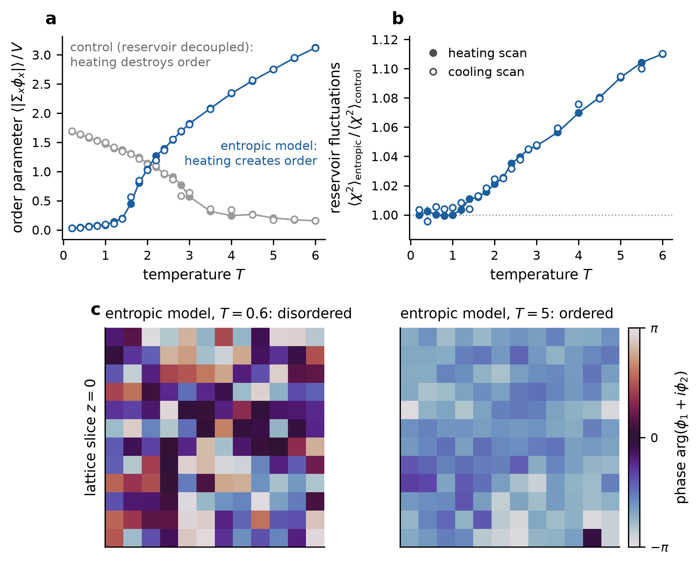

# A Superfluid at All Temperatures

**Blog post:** [Resisting Misalignment](https://bhaumik-institute.physics.ucla.edu/sites/default/files/news/resisting-misalignment/index.html), a non-technical introduction: a superfluid at every temperature, and
a chiral symmetry that stays broken however hot it gets.

**Paper:** S. Harder and A. Sharon, *A Superfluid at All Temperatures*, [arXiv:2610.10169](https://arxiv.org/abs/2610.10169) [hep-th].

This repository contains the code for the paper. The paper constructs unitary, local, 3+1-dimensional conformal field
theories with finitely many fields whose thermal state breaks a continuous global symmetry at every temperature.

## Contents

- [`superfluid/`](superfluid): the finite-$N$ beta functions, the fixed points of the family $\mathcal{T}_n$, Table I of
  the paper, and a check of the beta functions against PyR@TE 3.
- [`entropic_order/`](entropic_order): a Monte Carlo simulation of a lattice model in which heating creates superfluid
  order.

## Quick start

```sh
python -m venv .venv && source .venv/bin/activate
pip install -r requirements.txt
cd superfluid
python table1.py                        # Table I, a few seconds
python -m pytest -q test_rgengine.py    # 31 tests, about a minute
python pyrate_crosscheck.py             # downloads PyR@TE 3, about three minutes
cd ../entropic_order
python simulate_entropic_order.py --quick
```

## Table I

Output of `superfluid/table1.py`. Every entry agrees with the printed table at the printed precision.

| theory | $10^3\lambda_1^*$ | $10^3\lambda_2^*$ | $\Delta$ | $\theta^{\rm 1L}$ | $\theta^{\rm 2L}$ | $c_2^{\rm 2L}/\lambda_2^*$ | $D/D_{\rm LO}$ |
|---|---|---|---|---|---|---|---|
| $(150,783,5,26)$ | 1.468 | 2.517 | -33.47 | -1.844 | -1.700 | -0.793 | 0.221 |
| $(300,1562,10,52)$ | 2.130 | 2.476 | -38.25 | -1.957 | -1.828 | -1.79 | 0.261 |
| $\mathcal{T}_{5}$ | 1.271 | 2.517 | -41.85 | -2.230 | -2.143 | -0.588 | 0.200 |
| $\mathcal{T}_{9}$ | 1.156 | 1.368 | -34.60 | -1.796 | -1.728 | -5.76 | 0.477 |
| $\mathcal{T}_{13}$ | 0.871 | 0.941 | -33.20 | -1.725 | -1.678 | -13.9 | 0.555 |
| $\mathcal{T}_{21}$ | 0.564 | 0.580 | -32.43 | -1.687 | -1.659 | -39.2 | 0.641 |
| $\mathcal{T}_{41}$ | 0.294 | 0.296 | -32.06 | -1.670 | -1.655 | -155 | 0.735 |
| $\mathcal{T}_{101}$ | 0.120 | 0.120 | -31.93 | -1.664 | -1.658 | -951 | 0.827 |

The first two rows are theories $(N_1,N_{f,1},N_2,N_{f,2})$; $\mathcal{T}_n$ has $N_1=n^3$, $N_2=n$.

## Entropic order



[`entropic_order/`](entropic_order) contains a classical Monte Carlo simulation of a lattice model with the mechanism of
the paper: a small sector, here a two-component field $\phi$, orders when heated, because $N=32$ reservoir fields become
lighter once it condenses and fluctuate more (panel b). An ordinary superfluid, with the reservoir decoupled, melts instead
(panel a, grey). Unlike the conformal theories of the paper, the lattice model has a scale, so it shows the mechanism but
not order at all temperatures. Details are in [`entropic_order/README.md`](entropic_order/README.md).

## Acknowledgments

As stated in the paper, this work made substantial use of the AI system Claude (Opus 5.5, Anthropic), accessed through
the Claude Science research environment.

## Citation

```bibtex
@article{HarderSharon2026,
  author        = {Harder, Sven and Sharon, Adar},
  title         = {A Superfluid at All Temperatures},
  eprint        = {2610.10169},
  archivePrefix = {arXiv},
  primaryClass  = {hep-th},
  year          = {2026}
}
```

## License

MIT, see [`LICENSE`](LICENSE). `superfluid/rgengine.py` contains coefficients transcribed from PyR@TE 3 (Apache-2.0);
see [`THIRD_PARTY_NOTICES.md`](THIRD_PARTY_NOTICES.md).
